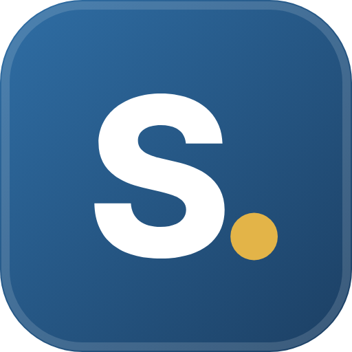

<p align="center">
  
</p>

<h1 align="center">EduSpruce</h1>
<p align="center"><b>Menos papelada. Mais tempo para ensinar.</b></p>
<p align="center">
  Plataforma de gestão escolar para professores — avaliação, sumários, horários, reuniões e direção de turma num único ficheiro, que funciona no iPad, no computador e no telemóvel.
</p>

<p align="center">
  
  
  
  
</p>

> 🇬🇧 **EduSpruce** is a single-file HTML/JavaScript school management app for Portuguese teachers (grading, lesson logs, timetables, meetings, class management). It runs offline in any modern browser, keeps all data on the teacher's own device, and can sync encrypted data through the teacher's own OneDrive or Google Drive. The interface is in European Portuguese.

---

## Índice

- [Funcionalidades](#funcionalidades)
- [Começar](#começar)
- [Alojar no GitHub Pages](#alojar-no-github-pages)
- [Sincronização entre dispositivos](#sincronização-entre-dispositivos)
- [Dados e privacidade](#dados-e-privacidade)
- [Interface](#interface)
- [Estrutura do projeto](#estrutura-do-projeto)
- [Compatibilidade](#compatibilidade)
- [Roteiro](#roteiro)
- [Licença](#licença)

---

## Funcionalidades

### Avaliação
- **Critérios e domínios** com ponderações, modelos por disciplina e cópia entre turmas.
- **Dois regimes de classificação**, definidos automaticamente pelo ano e pela disciplina:
  | | Ensino Básico Regular | Secundário · PROFIJ · Profissional |
  |---|---|---|
  | Testes | 0–100 % | 0–20 valores |
  | Final | Níveis 1–5 (tabela editável) | 0–20 valores |
  | Menções qualitativas | Sim | Não |
- **Arredondamento configurável** (casas decimais e regra): a nota que se vê é a que decide positiva/negativa, nível e menção.
- **Instrumentos de avaliação** com itens em árvore até 4 níveis (Grupo › Pergunta › Alínea › Subalínea), cotações e validação das classificações.
- **Avaliação oral** por momentos, com cotações globais ou próprias de cada momento, ligada aos itens de oralidade dos testes.
- **Análise de cada instrumento**: média, mediana, dispersão, histograma, dificuldade e discriminação de cada item, resultados por aluno.
- **Avaliação por módulos/UFCD** nas turmas profissionais e **MRA** (Mecanismo de Recuperação de Aprendizagens) integrado.
- **Evidências** por aluno e momento: fotografias (câmara direta no iPhone/iPad), gravação ou carregamento de áudio e ficheiros.
- **Perfil de aprendizagem** do aluno, com autoavaliação, evolução e modo de projeção.

### Turma
- **Painel da Turma**: indicadores clicáveis, «Precisa da sua atenção», agenda de 14 dias, tabela de alunos com filtros, assiduidade e documentação.
- **Aulas e sumários** com presenças, faltas, reposições e substituições.
- **Horários** anuais ou semanais (ensino profissional), importados de Excel.
- **Planta da sala**, fotografias dos alunos, relatórios individuais e documentos de direção de turma.

### Organização
- **Calendário escolar** (importado de PDF), marcação de testes, envio de matrizes, reuniões com atas e deliberações, tarefas.
- **Início personalizável** (simples ou geral), com cartões que se arrastam e redimensionam, contagem decrescente do período e efemérides.
- **Notas flutuantes** em qualquer ecrã.

### Administração
- **Contas locais e perfis** (Administrador, Professor e perfis personalizados) com permissões configuráveis.
- **Bloqueio dos dados de base** e bloqueio de períodos após a avaliação final.
- **Cópias de segurança** em JSON (opcionalmente encriptadas), caixote do lixo de 30 dias, auditoria e «Apagar Tudo».

---

## Começar

O EduSpruce é **um único ficheiro HTML**. Não precisa de instalar nada nem de um servidor.

1. Descarregue [`index.html`](index.html).
2. Abra-o no Safari, Chrome, Edge ou Firefox.
3. Entre com o utilizador **`admin`** e a palavra-passe **`admin`** — será pedido para a alterar no primeiro acesso.
4. Siga os **Primeiros Passos** no Início: escola e professor → ano letivo → disciplinas → turmas (importando o Excel com as fotografias) → alunos que frequentam a disciplina.

> 💡 Para experimentar sem dados reais, use **Definições › Ferramentas › Criar Demonstração**.

No iPad ou no iPhone, abra o endereço no Safari e escolha **Partilhar › Adicionar ao Ecrã Principal** para usar como uma app.

---

## Alojar no GitHub Pages

Alojar a app num endereço **https** permite iniciar sessão com o Microsoft 365 e sincronizar com o OneDrive ou o Google Drive.

1. Faça *fork* ou crie um repositório com o `index.html` na raiz.
2. Em **Settings › Pages**, escolha *Deploy from a branch*, ramo `main`, pasta `/ (root)`.
3. A app fica disponível em `https://<utilizador>.github.io/<repositório>/`.

Guia completo: [`docs/guias/PUBLICAR_GITHUB_PAGES.md`](docs/guias/PUBLICAR_GITHUB_PAGES.md).

> ⚠️ O repositório contém **apenas o código**. Os dados dos alunos nunca são enviados para o GitHub: ficam no navegador de cada professor.

---

## Sincronização entre dispositivos

Para ter os mesmos dados no iPad, no computador e no telemóvel, sem servidor próprio:

### OneDrive (Microsoft 365)
1. No [portal do Azure](https://portal.azure.com) › **Microsoft Entra ID › Registos de aplicações › Novo registo**.
2. Tipo de plataforma: **Single-page application (SPA)**; URI de redirecionamento: o endereço https da app.
3. Permissões delegadas do Microsoft Graph: `User.Read` e `Files.ReadWrite.AppFolder`.
4. Copie o **ID da Aplicação** e o **ID do Inquilino** para **Definições › Conta e Acesso › Microsoft 365**.

### Google Drive
1. Na [Google Cloud Console](https://console.cloud.google.com), crie um projeto e ative a **Google Drive API**.
2. Crie um **ID de cliente OAuth** do tipo *Aplicação Web*, com o endereço da app como origem autorizada.
3. Indique o ID do cliente no cartão de sincronização da nuvem, em **Definições › Dados e Segurança**.

Em cada dispositivo, entre com a mesma conta e use a **mesma palavra-passe de cifragem**. Os dados são cifrados no dispositivo (AES-GCM, chave derivada com PBKDF2) antes de sair, guardados na pasta da aplicação da sua própria nuvem, e fundidos automaticamente; os conflitos ficam guardados para rever.

Guia completo: [`docs/guias/CONFIGURAR_SINCRONIZACAO.md`](docs/guias/CONFIGURAR_SINCRONIZACAO.md).

---

## Dados e privacidade

O EduSpruce trata dados de alunos, muitos deles menores. Por isso:

- **Tudo fica no dispositivo** (localStorage e IndexedDB do navegador). Não há servidor do EduSpruce nem recolha de dados.
- A sincronização, quando ativada, usa **apenas a nuvem do próprio professor**, com os dados **cifrados** — nem a Microsoft nem a Google os conseguem ler.
- **Evidências** (fotografias e áudio) ficam só no dispositivo onde foram registadas e não entram na nuvem nem nas cópias JSON.
- A app **nunca escreve** na base de dados ou no programa de gestão da escola.
- **Apagar Tudo (100 %)** remove todos os dados do dispositivo: armazenamento, bases de dados, caches, cópias internas e definições.

> As permissões dos perfis protegem a interface no próprio dispositivo. Num cenário com vários utilizadores a partilhar os mesmos dados é necessário um servidor, com o respetivo acordo de tratamento de dados (RGPD).

---

## Interface

- **Responsiva por dispositivo**, com deteção automática:
  - **Computador** — barra lateral completa e atalhos de teclado.
  - **iPad** — alvos de toque de 44 px, barra lateral compacta ao alto, barra de ações em baixo deitado.
  - **Telemóvel** — barra de separadores inferior, cartões numa coluna e tabelas em fichas.
- **Estilos**: EduSpruce, Azul Corporativo, Coral, Social, Gradiente, Institucional e Académico.
- **Tema** claro, escuro ou automático, cores de destaque e temas sazonais.
- **Acessibilidade**: navegação por teclado, leitores de ecrã, contraste e redução de animações.

Tudo em **Definições › Aparência**.

---

## Estrutura do projeto

```
.
├── index.html               # a aplicação completa (HTML + CSS + JavaScript, sem dependências)
├── manifest.webmanifest     # instalação como app (PWA)
├── favicon.png
├── icons/                   # ícones da app (192, 512, maskable, iOS)
├── docs/
│   ├── ESPECIFICACAO.md     # especificação funcional e histórico de versões
│   ├── FORMATO_DADOS.md     # formato dos dados guardados
│   ├── ROADMAP.md · SUGESTOES.md
│   ├── guias/
│   │   ├── PUBLICAR_GITHUB_PAGES.md
│   │   └── CONFIGURAR_SINCRONIZACAO.md
│   └── logo.png
├── .github/ISSUE_TEMPLATE/  # modelos «Problema» e «Sugestão»
├── CHANGELOG.md · CONTRIBUTING.md · SECURITY.md · LICENSE
├── .gitignore               # impede o envio de dados de alunos (JSON, Excel, CSV, PDF)
└── .nojekyll
```

Bibliotecas embutidas no próprio ficheiro (comprimidas): leitura de Excel e PDF, geração de PDF e OCR, usadas apenas localmente.

### Formato dos dados

O estado da app é um objeto JSON (`anos › turmas › alunos, instrumentos, critérios…` e `cfg` com as definições). O formato completo está em [`docs/FORMATO_DADOS.md`](docs/FORMATO_DADOS.md). As cópias de segurança exportadas usam o mesmo formato e podem ser reimportadas noutro dispositivo.

---

## Compatibilidade

| Navegador | Suporte |
|---|---|
| Safari (iPadOS / iOS 16+) | ✅ recomendado no iPad |
| Chrome / Edge 110+ | ✅ |
| Firefox 115+ | ✅ |

Requer JavaScript ativo. A câmara e o microfone (evidências) exigem https ou ficheiro local, conforme o navegador.

---

## Roteiro

- [ ] Sincronização opcional e cifrada das evidências
- [x] Manifesto para instalar como app (PWA)
- [ ] Atualização automática (service worker)
- [ ] Modo escola: vários professores com servidor próprio
- [ ] Importação direta dos ficheiros do programa de gestão escolar (só leitura)

Sugestões e problemas: abra uma [*issue*](../../issues) ou use **Definições › Ferramentas › Enviar Sugestão ou Problema** na app.

---

## Licença

© 2026 Joel Cunha. Todos os direitos reservados — ver [`LICENSE`](LICENSE).

<!-- Se preferir uma licença aberta, substitua por MIT, GPL-3.0, etc. e acrescente o ficheiro LICENSE. -->

## Documentos legais

- [Política de Privacidade](https://eduspruce.app/privacidade.html)
- [Termos de Serviço](https://eduspruce.app/termos.html)
